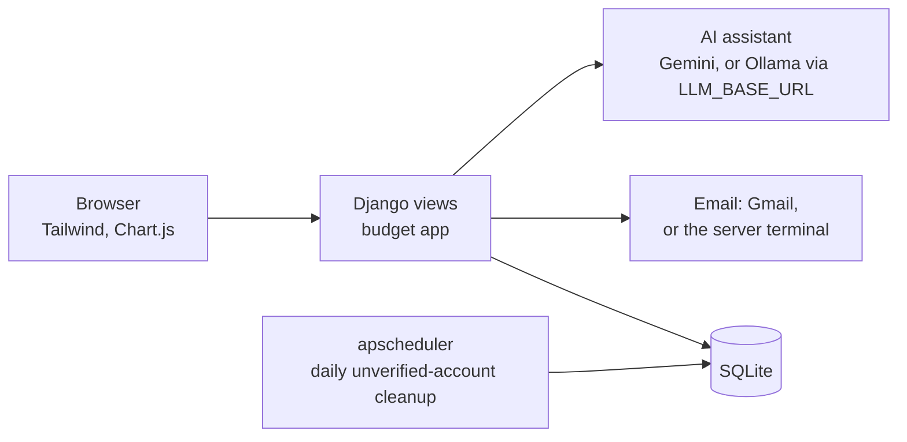

# PennywAIse

Django budgeting dashboard: log income and expenses, see where the money went, and ask an AI assistant general finance questions.


*Recorded on a local run with Playwright. The six months of history is seeded sample data, and the AI answer came from qwen3:8b running locally in Ollama.*

## My part

A three-person university project. By author name, 92 of the 139 commits are mine (85 under my name, 7 under my GitHub login). I built authentication, the email workflows (verification link, password reset), models and the Tailwind integration. Amielle Jaezxier Perez built the testing framework, models and business logic and frontend UI. Nikka Joie Mendoza built frontend UI and refinement and the Tailwind integration.

**Proof:** a six-month trend, category breakdown and month-end projection on the dashboard; the test suite has 273 tests, of which 170 pass and 103 fail (details under Tests).

There is no hosted demo: the free-tier host suspended the original deployment in October 2026.

## What it is and why

You record income and expenses by category and the dashboard shows monthly totals, a six-month trend, a category breakdown and a projected month-end balance. You can set a monthly budget overall or per category, export entries to CSV, and ask the assistant budgeting questions. It was a course project to build a full Django app with real auth rather than a single-page toy.

## What was hard

- **Auth that cannot be skipped.** An account stays inactive until its emailed verification link is used, a daily job removes accounts left unverified for 48 hours (while the dev server runs), and every query is filtered to the signed-in user's own records. Without Gmail credentials the emails print to the server terminal, so registration still works locally.
- **An assistant that does not know your numbers.** It only forwards your question to the model and does not read your transactions or budgets, so I did not claim personalised advice. It talks to Gemini by default or to any OpenAI-compatible server through `LLM_BASE_URL` and `LLM_MODEL`; the recording used a local Ollama.
- **Honest security.** Passwords use Django's default hashing and nothing else is encrypted at field level; the README says so rather than claiming more.

## Architecture



## Run it

```bash
git clone https://github.com/Exalt24/PennywAIse.git && cd PennywAIse
printf 'SECRET_KEY=local-dev-key\nDEBUG=True\n' > .env
npm install && pip install -r requirements.txt && python manage.py migrate
python manage.py create_test_accounts     # log in with test@example.com / password123
npm run dev                               # http://127.0.0.1:8000/
```

The AI settings, email options and a short user guide are in [docs/SETUP.md](docs/SETUP.md).

## Tests

```bash
python manage.py test budget
```

I ran it on 2026-10-17: 273 tests, 170 pass and 103 fail or error (28 failures, 75 errors). They were written against earlier versions of the app: they create categories that a signal now creates for every new user, expect response keys that have since changed, and predate the email verification flow. They are stale, not fixed, and there is no CI workflow.

## Limits and not done

- 103 of the 273 tests are stale and fail.
- The assistant answers general questions only and cannot discuss your own transactions.
- Reminders, alerts and notifications do not exist; over-budget is shown in red only.
- The default Gemini model id in `budget/views.py` is an old preview, and the Gemini path was not exercised for the recording.
- Charts load Chart.js and marked from a CDN, so the dashboard needs internet access in the browser.
- No hosted demo.

## Stack

Python, Django 5.2, SQLite, Tailwind CSS 4, Chart.js, django-apscheduler, Google Gemini or any OpenAI-compatible model server.

## License

MIT, see [LICENSE](LICENSE).
