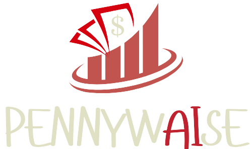

# PennywAIse


*Recorded on a local run with Playwright. The six months of history is seeded sample data, and the AI answer came from qwen3:8b running locally in Ollama.*

<div align="center">

[](https://www.python.org/downloads/)
[](https://www.djangoproject.com/)
[](https://tailwindcss.com/)
[](https://www.chartjs.org/)
[](https://opensource.org/licenses/MIT)
[](https://github.com/Exalt24/PennywAIse)

</div>

<div align="center">



</div>

## Demo

There is no hosted demo. The free-tier host suspended the original deployment in October 2026, so the links that used to be here led to empty pages and were removed. The GIF above was recorded on the local stack described under Installation & Setup. Everything runs locally from those steps.

## 🔍 Overview

PennywAIse is a Django budgeting dashboard. You record income and expenses by category, and it shows where the money went with monthly totals, a six-month trend, a category breakdown and a projected month-end balance. You can set a monthly budget overall or per category, export your entries to CSV, and ask an AI assistant general personal-finance questions.

## ✨ Key Features

### 🤖 AI Assistant
- **Chat panel**: the AI Assistant tab answers general budgeting and saving questions.
- **Gemini by default**: it uses the Google Gemini API when `GENAI_API_KEY` is set.
- **Any OpenAI-compatible server instead**: set `LLM_BASE_URL` and `LLM_MODEL` (for example a local Ollama at `http://localhost:11434/v1`) and no Gemini key is needed. The recording above used this with qwen3:8b.
- **What it does not do**: it only sends your question to the model. It does not read your transactions or budgets, so it cannot answer questions about your own numbers. The Gemini path was not exercised for the recording, and the default Gemini model id in `budget/views.py` is an old experimental preview, so set `LLM_MODEL` to a current model if you use Gemini.

### 🔐 Security basics
- **Authentication**: registration with an emailed verification link (the account stays inactive until it is used, and a daily job removes accounts left unverified for 48 hours while the dev server is running), login by email, and a password reset link that is valid for 24 hours. Sessions use Django's built-in authentication.
- **Protected routes**: the dashboard, the entry and report filter endpoints and the AI endpoint require a signed-in user, and every query is filtered to that user's own records.
- **Password storage**: passwords are hashed with Django's default password hashing. No other field-level encryption is implemented.

### 💰 Financial Management
- **Transaction tracking**: add, edit and delete income and expense entries (title, amount, date, category, optional note of up to 80 characters).
- **Categories**: every new user gets Food, Transport, Entertainment, Utilities and Other, and can add, rename and delete their own.

### 📊 Dashboard
- **Snapshot**: this month's income, expenses and net balance, with comparisons to last month, the largest income and expense, and the average transaction.
- **Charts**: a six-month income and expense trend (bar or line), a pie chart of spending by category, and budget utilization.
- **Projection**: a month-end balance estimate based on the average daily spend so far.

### 🎯 Budgets
- **Budget creation**: set a monthly budget overall or for a single category.
- **Remaining amounts**: the Budgets tab and the dashboard show spent and remaining, in red when you are over. There are no notifications or alerts.

### 📤 Data Portability
- **CSV export**: the Reports tab filters entries by date range, type and category, and Export CSV downloads exactly that selection.

## 🚀 Installation & Setup

### Prerequisites
- Python 3.8 or higher (Django 4.2; run here on Python 3.13)
- Node.js 18 or newer (run here on Node 24) and npm
- Git
- Internet access in the browser, because Chart.js and marked load from the jsDelivr CDN

### Step 1: Clone the Repository
```bash
git clone https://github.com/Exalt24/PennywAIse.git
cd PennywAIse
```

### Step 2: Configure Environment
Create a `.env` file in the project root. Only `SECRET_KEY` and `DEBUG` are needed to start the app:

```dotenv
SECRET_KEY=<your-secret-key>
DEBUG=True                # must be True for local use; with False only the old Render host is allowed

# AI assistant: use one of these two
GENAI_API_KEY=<your-gemini-api-key>
# LLM_BASE_URL=http://localhost:11434/v1
# LLM_MODEL=qwen3:8b
# LLM_REASONING_EFFORT=none   # optional: skips the thinking step of local reasoning models such as qwen3

# Optional: send verification and reset emails through Gmail
# GMAIL_ADDRESS=<your-gmail>@gmail.com
# GMAIL_APP_PASS=<your-16-char-app-password>
```

Without the Gmail values, the verification and reset emails are printed to the terminal running the server, so you can still register by opening the link from there. Without an AI setting, the app runs and the assistant replies that it is not configured.

#### Generate a Secure Secret Key
```bash
python -c "import secrets; print('SECRET_KEY=' + secrets.token_urlsafe(50))"
```

### Step 3: Install Dependencies
```bash
# Install frontend dependencies
npm install

# Install backend dependencies (a virtual environment is a good idea)
pip install -r requirements.txt
```

### Step 4: Initialize Database
```bash
python manage.py migrate
```

### Step 5: Create Test User (Development Only)
```bash
python manage.py create_test_accounts
# Creates user "testuser"; log in with test@example.com / password123
```

### Step 6: Launch Development Server
```bash
npm run dev
```

The application will be available at `http://127.0.0.1:8000/` with Tailwind CSS rebuilding on change. The first run builds the stylesheet, so give it a few seconds. To use another port, run `python manage.py runserver 4950` and `npm run watch:css` (or `npm run build:css` once) in two terminals instead.

## 🧪 Testing

```bash
python manage.py test budget
```

The suite has 273 tests. 170 pass and 103 fail or error. Those tests were written against earlier versions of the app and have not been updated: for example they create categories that a signal now creates for every new user, they expect response keys that have since changed, and they predate the email verification flow. Treat a failure there as a stale test until you have looked at it.

## 📘 User Guide

1. **Authentication**: log in with the test account, or register and open the verification link from your email (or the server terminal).
2. **Dashboard**: this month's totals, the six-month trend, the category pie and the budget chart.
3. **Adding transactions**: the Add Entry button in the sidebar opens a form for title, amount, date, type, category and notes.
4. **Budgets**: pick Total Budget or a category, enter an amount and save.
5. **Reports**: filter by date, type and category, then Export CSV.
6. **AI Assistant**: type a general budgeting question and press Get Answer.

## 👥 Team & Contributions

| Team Member            | Primary Responsibilities                                       |
|------------------------|---------------------------------------------------------------|
| Amielle Jaezxier Perez | Testing framework, Models & business logic, Frontend UI        |
| Daniel Alexis Cruz     | Authentication, Email workflows, Models, Tailwind integration  |
| Nikka Joie Mendoza     | Frontend UI & refinement, Tailwind Integration                 |

## 🌐 Future Roadmap

- **Mobile Application**: Native mobile experience for iOS and Android
- **Financial Goal Setting**: Track progress toward saving and investment goals
- **Investment Portfolio Integration**: Connect and monitor investment accounts
- **Advanced AI Forecasting**: Predictive analysis of future expenses and income
- **Multi-currency Support**: Handle transactions in multiple currencies

## 📄 License

This project is licensed under the MIT License - see the [LICENSE](LICENSE) file for details.

## 🙏 Acknowledgements

- [Django](https://www.djangoproject.com/) - The web framework used
- [Tailwind CSS](https://tailwindcss.com/) - For responsive UI components
- [Chart.js](https://www.chartjs.org/) - Interactive data visualizations
- [Google Gemini API](https://ai.google.dev/) - The default backend of the AI assistant
- [Ollama](https://ollama.com/) - Local model server used for the recording
- [Render](https://render.com/) - Hosted the original demo, which is now offline

---

<div align="center">
  <p>Developed by the PennywAIse Team at <a href="https://github.com/Exalt24/PennywAIse">Exalt24</a></p>
  <p><i>Take control of your financial future</i></p>
</div>
