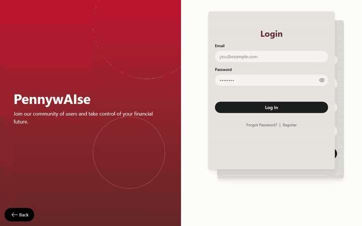
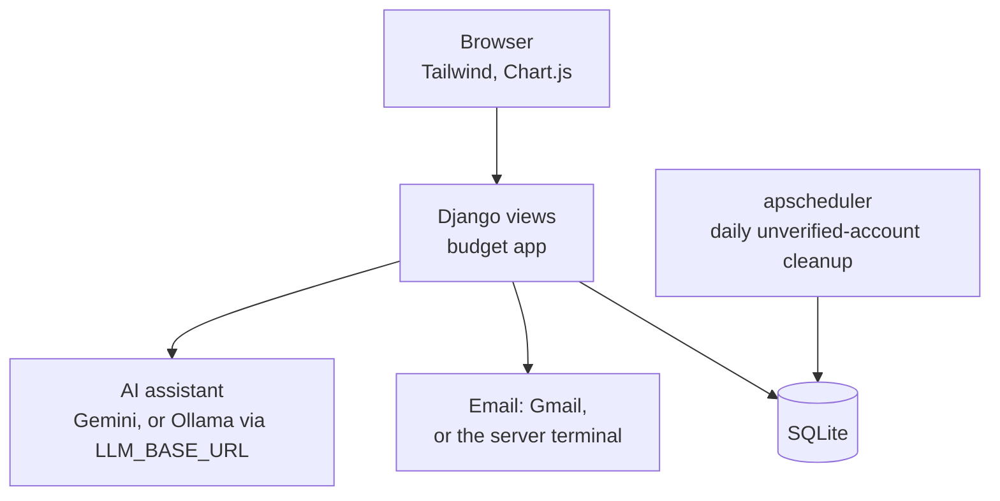

# PennywAIse

[](https://github.com/Exalt24/PennywAIse/actions/workflows/ci.yml)

Django budgeting dashboard: log spending, see monthly totals and ask an AI assistant general finance questions.



*Recorded on a local run with Playwright. The six months of history is seeded sample data, and the AI answer came from qwen3:8b running locally in Ollama.*

## My part

A three-person university project, written between 26 April and 3 May 2025. Of the 127 commits made in that window, 83 are mine, 39 are Nikka Joie Mendoza's and 5 are Amielle Jaezxier Perez's (by author name). The commits since then are my cleanup, the test and CI repair, the README and Dependabot's updates. What the history shows each of us touching:

- **Me:** the project setup and Tailwind build, login and register, email verification and password reset, the daily cleanup job for unverified accounts, per-user default categories, entry create, edit and delete, budgets, CSV export, the Chart.js dashboard with the month-end projection, the AI assistant page and most of the changes to `budget/views.py` and `budget/models.py`.
- **Nikka:** page templates and styling under `budget/templates/main` and `budget/static`: the home page design, login and register layout, sidebar, header and profile dropdown, dashboard cards, filters, pagination look, mobile responsiveness and the floating AI chat button.
- **Amielle:** the test files `budget/test_*.py` and `budget/README_TESTS.md` (two commits, 28 and 29 April), plus two commits on 1 May that comment out and restore the Gemini client setup in `budget/views.py`.

**Proof:** 303 tests pass in CI on every push (the badge above is that run: 303 tests, OK, in 77 seconds), and the dashboard shows a six-month trend, a category breakdown and a month-end projection, as in the recording on seeded sample data.

There is no hosted demo: the free-tier host suspended the original deployment in October 2026.

## What it is and why

You record income and expenses by category and the dashboard shows monthly totals, a six-month trend, a category breakdown and a projected month-end balance. You can set a monthly budget overall or per category, export entries to CSV, and ask the assistant budgeting questions. It is a full Django app with real auth, tests and CI.

## What was hard

- **Auth that cannot be skipped.** An account stays inactive until its emailed verification link is used, a daily job removes accounts left unverified for 48 hours (while the dev server runs), five wrong passwords lock that email's login for 15 minutes, and every query is filtered to the signed-in user's own records. Without Gmail credentials the emails print to the server terminal, so registration still works locally.
- **An assistant that does not know your numbers.** It only forwards your question to the model and does not read your transactions or budgets, so I did not claim personalised advice. It talks to Gemini by default or to any OpenAI-compatible server through `LLM_BASE_URL` and `LLM_MODEL`; the recording used a local Ollama.
- **Security.** Passwords use Django's default hashing and nothing else is encrypted at field level.

## Architecture



## Run it

```bash
git clone https://github.com/Exalt24/PennywAIse.git && cd PennywAIse
printf 'SECRET_KEY=local-dev-key\nDEBUG=True\n' > .env
npm install && pip install -r requirements.txt && python manage.py migrate
python manage.py create_test_accounts     # log in with test@example.com / password123
npm run dev                               # http://127.0.0.1:8000/
```

The AI settings, email options and a short user guide are in [docs/SETUP.md](docs/SETUP.md).

## Tests

```bash
python manage.py test budget
```

303 tests, all passing. GitHub Actions runs them on every push and pull request (`.github/workflows/ci.yml`, Python 3.13), along with `manage.py check` and a check that the migrations match the models; the badge at the top is that run. The suite was written in April 2025 and had drifted from the app: 103 of its 273 tests failed in October 2026. Fixing it also turned up real bugs, which are fixed and covered by tests: password reset for an unverified account, a duplicate-entry message that crashed on Windows, a 500 on a malformed date or category id in the filters and the CSV export, a 500 on a dashboard POST that names no action, and an AI call that failed with something other than a Gemini client error.

The AI tests mock the model clients, so no key or local model server is needed, and CI sets `SECRET_KEY` and `DEBUG` as environment variables instead of reading a `.env` file.

## Limits and not done

- The assistant answers general questions only and cannot discuss your own transactions.
- Reminders, alerts and notifications do not exist; over-budget is shown in red only.
- The login lockout counter lives in Django's cache, so with the default in-memory cache it is kept per server process.
- The default Gemini model id in `budget/views.py` is an old preview, and the Gemini path was not exercised for the recording.
- Charts load Chart.js and marked from a CDN, so the dashboard needs internet access in the browser.
- No hosted demo.

## Stack

Python, Django 5.2, SQLite, Tailwind CSS 4, Chart.js, django-apscheduler, Google Gemini or any OpenAI-compatible model server.

## License

MIT, see [LICENSE](LICENSE).

By Daniel Alexis Cruz, [dacruz.vercel.app](https://dacruz.vercel.app), with Nikka Joie Mendoza and Amielle Jaezxier Perez.
